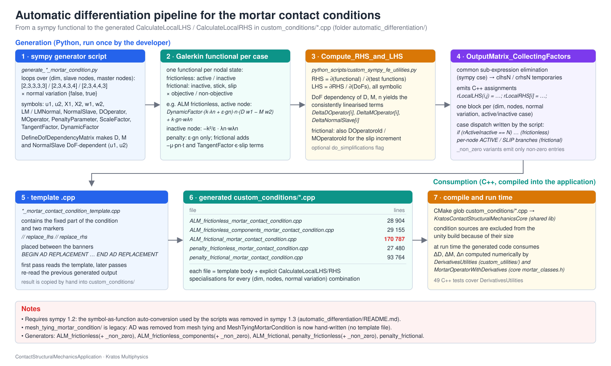

# Automatic differentiation of the mortar contact conditions

The `CalculateLocalLHS` / `StaticCalculateLocalRHS` methods of the ALM and penalty mortar contact conditions are **generated** with sympy from the Galerkin functional of each contact state: the functional is differentiated symbolically with respect to the test functions (RHS) and the degrees of freedom (LHS) and printed as C++ into a template. The derivatives of the mortar operators, dual shape functions and normals are *not* differentiated symbolically — they are declared as functions of the DoFs ("AD exceptions") and replaced by the arrays that `DerivativesUtilities` fills at run time (thesis Appendix C).

## Layout

| File / folder | Role |
|---|---|
| `mortar_condition_generator.py` | **Shared generator module**: symbols and kinematics (`SymbolSet`), family descriptions (`FamilySpec`: C++ preambles, active-set branch layout), differentiation, printing, assembly of the file (`Generate`) and the command line of the scripts (`Main`). |
| `../python_scripts/custom_sympy_fe_utilities.py` | Symbolic helpers on top of the core `kratos/python_scripts/sympy_fe_utilities.py`: DoF-dependency injection, replacement of the derivative nodes by plain symbols, C++ output with collected factors. Runs on any modern sympy. |
| `<family>/generate_<family>.py` | Thin command-line generator of one family: the **functional** of each branch (the physics) and the call to `Generate`. |
| `<family>/<family>.ipynb` | The **documented** version of the same generator: markdown cells with the formulation (thesis equations, sign conventions, symbol table) and the same code cells as the script. Rendered by GitHub / Jupyter. |
| `<family>/*_template.cpp` | C++ template with the `// replace_lhs` / `// replace_rhs` markers (hand-maintained, together with the headers in `../custom_conditions/`). |
| `run_notebook.py` | Executes a notebook headlessly (standard library only; uses `nbclient` when installed). |
| `compare_generated_conditions.py` | Numerical comparison of two generated files (evaluates every specialisation / node / branch on random inputs). Use it to verify a regeneration. |

| Folder | Class | Generated file (in `../custom_conditions/`) | Branches per slave node |
|---|---|---|---|
| `ALM_frictionless_mortar_condition/` | `AugmentedLagrangianMethodFrictionlessMortarContactCondition` (scalar multiplier) | `ALM_frictionless_mortar_contact_condition.cpp` | inactive / active |
| `ALM_frictionless_components_mortar_condition/` | `AugmentedLagrangianMethodFrictionlessComponentsMortarContactCondition` (vector multiplier, tangential part penalised) | `ALM_frictionless_components_mortar_contact_condition.cpp` | inactive / active |
| `ALM_frictional_mortar_condition/` | `AugmentedLagrangianMethodFrictionalMortarContactCondition` | `ALM_frictional_mortar_contact_condition.cpp` (~119 k lines) | inactive / slip / stick × objective / non-objective |
| `penalty_frictionless_mortar_condition/` | `PenaltyMethodFrictionlessMortarContactCondition` | `penalty_frictionless_mortar_contact_condition.cpp` | inactive / active |
| `penalty_frictional_mortar_condition/` | `PenaltyMethodFrictionalMortarContactCondition` | `penalty_frictional_mortar_contact_condition.cpp` | inactive / slip / stick |
| `mesh_tying_mortar_condition/` | – | – | **legacy**: mesh tying is hand-written now; only the old generator and the theory note `mesh_tying_mortar_condition.tex` are kept |

## How the generation works

1. For every geometry pair (`2D2N`, `3D3N`, `3D4N`, `3D3N4N`, `3D4N3N`) and every value of `TNormalVariation`, `SymbolSet` defines the symbols `u1, u2, X1, X2` (displacements and coordinates), the test functions `w1, w2, wLM`, the multipliers, `NormalSlave`, `TangentSlave`, `DOperator`, `MOperator` (+ `u1old, u2old, DOperatorold, MOperatorold` for friction), the parameters `DynamicFactor`, `PenaltyParameter`, `ScaleFactor`, `TangentFactor`, `mu`, and the derived quantities (weighted gap, multiplier components, objective / non-objective slips).
2. `DefineDofDependencyMatrix` makes `DOperator`, `MOperator` (and `NormalSlave` when the normal variation is on) undefined functions of the DoFs, so that their derivatives appear as `Derivative` nodes.
3. For every slave node and every active-set branch the family functional is evaluated and `Compute_RHS_and_LHS` differentiates it (`r = ∂R/∂w`, `K = −∂r/∂d`, DoFs ordered `[master displacements, slave displacements, multipliers]`).
4. `BuildDependencyReplacement` / `ReplaceDependenciesBySymbols` map `F_i_j(dofs)` to `F_i_j` and `Derivative(F_i_j(dofs), dof_k)` to `DeltaF_k_i_j`; `Output*_CollectingFactorsNonZero` runs `sympy.cse`, prints C++ (`std::pow`, `+=` on the non-zero entries only) and rewrites the indices as `F(i,j)`, `DeltaF[k](i,j)`, `v[i]`.
5. The bodies are wrapped in the per-node dispatch (`if (r_geometry[i].IsNot(ACTIVE)) {…} else …`), the template parameters are substituted and everything is inserted at the markers of the template in one go. The RHS does not depend on the derivatives of the normal: `StaticCalculateLocalRHS` is generated for `TNormalVariation = false` only and the `true` specialisation is a one-line forwarder to it.

## Regenerating a condition

Requirements: Python 3 and sympy (any modern version; tested with 1.14). A compiled Kratos is not needed (the core `sympy_fe_utilities.py` is imported from the source tree when `KratosMultiphysics` is not importable).

~~~sh
cd applications/ContactStructuralMechanicsApplication/automatic_differentiation
# command line (any cwd works; --help lists the options)
python3 ALM_frictional_mortar_condition/generate_frictional_mortar_condition.py
# or the notebook, headless
python3 run_notebook.py ALM_frictional_mortar_condition/ALM_frictional_mortar_condition.ipynb
# quick partial run for a test
python3 ALM_frictional_mortar_condition/generate_frictional_mortar_condition.py --combinations 2,2,2 --normal-variation false --output-dir /tmp/check
~~~

The generated file is written directly into `../custom_conditions/`. The whole ALM frictional family takes roughly one to two hours single-threaded; the frictionless families a few minutes. The five families are independent and can run in parallel. Then:

1. Compare with the previous file if the change was not meant to alter the numerics: `python3 compare_generated_conditions.py <old>.cpp ../custom_conditions/<new>.cpp` (use `--common-only` for a partial regeneration).
2. Rebuild the application and run the C++ suite and `tests/test_ContactStructuralMechanicsApplication.py -l small` (the small suite includes `test_symbolic_generation.py`, which regenerates the ALM frictionless `2D2N` case and compares it with the committed file); the nightly and validation suites contain the multi-step frictional cases.

The headers in `custom_conditions/` and the templates are hand-written: they must stay consistent with the DoF ordering and with the symbol names used by the module (`FamilySpec.preamble_*`).

## Full documentation

- [Automatic differentiation](https://kratosmultiphysics.github.io/Kratos/pages/Applications/Contact_Structural_Mechanics_Application/Theory/Automatic_Differentiation.html) · [source](../../../docs/pages/Applications/Contact_Structural_Mechanics_Application/Theory/Automatic_Differentiation.md)
- [Frictionless contact](../../../docs/pages/Applications/Contact_Structural_Mechanics_Application/Theory/Frictionless_Contact.md) · [Frictional contact](../../../docs/pages/Applications/Contact_Structural_Mechanics_Application/Theory/Frictional_Contact.md) (the formulations behind the functionals)
- [Linearisation and derivatives](../../../docs/pages/Applications/Contact_Structural_Mechanics_Application/Theory/Linearisation_And_Derivatives.md) (the externally computed derivatives) · [Conditions](../../../docs/pages/Applications/Contact_Structural_Mechanics_Application/Implementation/Conditions.md)
