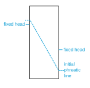
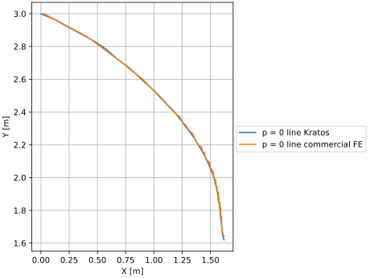
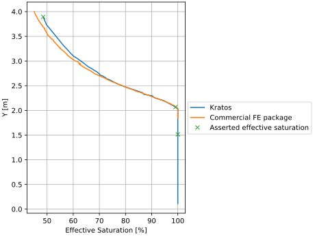
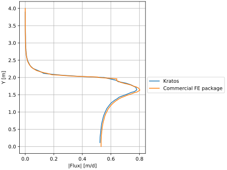
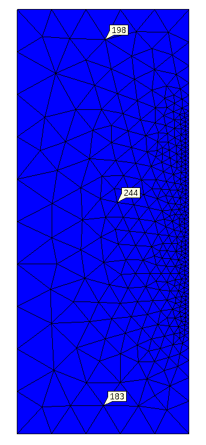

# Semi-Muskat problem

This test is based on the Muskat problem, but instead of a seepage boundary on the right side of the model, a fixed hydrostatic pressure is applied to the right boundary. The test performs a steady state water pressure calculation (using SteadyStatePwElement2D6N elements) using a Van Genuchten retention law to describe the permeability and (effective) saturation behavior depending on the water pressures. Next to the variant with the Van Genuchten retention law, there is also a simplified variant, with a fully saturated retention law. Finally, the [full Muskat problem](#full-muskat-problem-with-seepage-boundary) with an actual seepage boundary is available as a third variant.

## Setup

The test is performed in a single stage, with the following constraints and condition:
- The initial condition for the water pressure is a phreatic line with the profile as depicted in the schematic below. The coordinates of the phreatic line are (-0.05, 3.22), (0.25, 3.22), (1.6, 0.48), (1.7, 0.48). Due to the linear nature of the saturated variant, it does **not** require this initial phreatic line.
- For the left boundary, the water pressure is prescribed using a hydrostatic profile with reference coordinate of 3.0m
- For the right boundary, the water pressure is prescribed using a hydrostatic profile with reference coordinate of 1.62m. Using this fixed boundary instead of a seepage boundary is the main difference with the traditional Muskat problem.

A schematic of this  can be found in the figure below:

## Results

The following outputs are used as first-reference results for this test, computed using a commercial FEM package:
- Phreatic line evolution (reference: `expected_phreatic_line.csv`).
- Hydrostatic response values (reference: `expected_saturation_at_x_1_52.csv`).
- The magnitude of the fluid flux vector (reference: `expected_fluxes_at_x_1_52.csv`).

The results in this section depict the results of the variant with Van Genuchten retention behavior. The graphs of the fully saturated results are available as .svg files in the respective [test folder](saturated_hydrostatic).

The phreatic line profile is visualized below. The profile is an estimation of the p=0 line. For the commercial package, the nodes with the lowest absolute pressures (close to zero) are plotted. For the Kratos result, Delaunay triangulation is used to find the p=0 isoline.

The saturation profile at x = 1.52 (10 cm from the right boundary) is visualized below:

The fluid flux profile at x = 1.52 is visualized below:

## Assertions
As seen in the results, the water pressures and effective saturations still show significant differences between Kratos and the commercial package. Therefore, regression values are checked for now. When changes are made to the model/implementation, the (autogenerated) profiles shown in the previous section can be used to assess whether the changes are an improvement.

The following assertions are done on the model:
- At three representative nodes (see figure at the bottom of the file), the water pressures and fluid flux vectors are checked for regressions.
- At three representative nodes (see also the effective saturation plot), the effective saturation is checked for regressions.

The representative water pressure nodes are shown in the picture below

## Full Muskat problem with seepage boundary

The test in the folder [van_genuchten_with_seepage](van_genuchten_with_seepage) is the 'real' Muskat problem. It uses the same geometry and Van Genuchten material as the semi-Muskat variant, but the right boundary is split in two parts:
- Below the seepage point, the water pressure is prescribed using a hydrostatic profile with reference coordinate of 0.48 m.
- Above it, a seepage boundary (`ApplySeepageBoundaryProcess`) is applied, which lets the water leave the model where the pressure would otherwise become positive.

The left boundary is hydrostatic with reference coordinate 3.22 m, and the initial water pressure is based on a phreatic line through (-0.25, 3.22), (0.05, 3.22), (1.6, 0.48), (1.7, 0.48). The calculation is a single-stage steady state groundwater flow calculation.

The first-reference results (computed using a commercial FEM package) are:
- Phreatic line (reference: `expected_phreatic_line.csv`), plotted in `phreatic_line.svg`.
- Effective saturation at x = 1.62 (reference: `expected_saturation_at_x_1_62.csv`), plotted in `saturation_for_x_1_62.svg`.
- Magnitude of the fluid flux at x = 1.62 (reference: `expected_flux_at_x_1_62.csv`), plotted in `fluxes_for_x_1_62.svg`.

The plots are generated by the test when plotting is enabled. As for the other variants, regression values are asserted for the water pressure, effective saturation and fluid flux vector at three representative nodes (37, 72 and 97).
