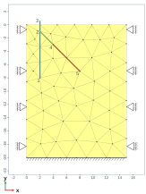

# Grouted anchor test

This test models a 2D plane-strain soil body with a sheetpile wall that is held by a grouted anchor. The anchor consists of a free (ungrouted) part, which is a truss attached to the sheetpile, and a grouted part, which is a truss connected to the surrounding soil by a line interface element. It checks the interaction between soil, a beam, truss elements and a grout-soil interface in a single static stage.

## Setup

The test consists of a single stage (`1_Initial_stage`) with a static, drained analysis (`U_Pw`, Newton-Raphson, one time step of 1.0 s). A schematic depiction of the model is shown below.

- Geometry and elements (see `Sheetpile_with_anchor.mdpa`):
    - `Soil` (yellow in schematic): `SmallStrainUPwDiffOrderElement2D6N`.
    - `Sheetpile` (blue in the schematic): `LinearTimoshenkoCurvedBeamElement2D3N`.
    - `Anchor_grouted` (brown in the schematic): `LinearTrussElement2D3N`.
    - `Anchor_free` (green in the schematic): `LinearTrussElement2D2N`.
    - `Grout_soil_interface` (between the grouted anchor and the edges of the soil elements): `Geo_UPwLineInterfacePlaneStrainDiffOrderElement3Plus3N`.

- Constraints:
    - Displacements in the X- and Y-direction of the bottom boundary (`Bottom_Fixed`) are fixed.
    - Displacements in the X-direction of the left and right edges (`Left_Edge`, `Right_Edge`) are fixed.
    - The water pressure in the soil is fixed to 0.

- Loads:
    - Gravity is applied as a `VOLUME_ACCELERATION` of -9.81 m/s² in the Y-direction.

- Materials (see `MaterialParameters.json`):
    - Soil: `GeoLinearElasticPlaneStrain2DLaw` (Young's modulus 2.0e7 Pa, Poisson's ratio 0.3) with a constant pore-water pressure field.
    - Sheetpile: `TimoshenkoBeamElasticConstitutiveLaw` (Young's modulus 2.1e11 Pa, cross area 1.5e-2 m², I33 3.0e-4 m⁴).
    - Grouted anchor part: `TrussConstitutiveLaw` (Young's modulus 4.6e+10 Pa, cross area 1.77e-02 m²). The cross area is consistent with the perimeter of the grouted anchor given in the interface. The Young's modulus is calculated from the free anchor Young's modulus, the assumed Young's modulus of 30 GPa for concrete and it's cross area and the cross area of the grout body (consisting of the steel anchor and the surrounding concrete). 
    - Free anchor part: `TrussConstitutiveLaw` (Young's modulus 2.1e11 Pa, cross area 4.938e-3 m²).
    - Grout-soil interface: `GeoIncrementalLinearElasticInterfaceLaw` (normal stiffness 7.69e8 Pa/m, shear stiffness 7.69e7 Pa/m). The perimeter of the grouted anchor is given using the `GEO_CONTACT_SURFACE_PERIMETER` and is consistent with the cross area of the grouted anchor part.

## Assertions

The test (`test_grouted_anchor.py`) runs the stage with the sequential orchestrator and reads the `DISPLACEMENT` results from `Sheetpile_with_anchor.post.res`. At time 1.0, the displacement vectors of nodes 1 to 5 are compared with regression values:

| Node | Displacement X [m] | Displacement Y [m] |
|------|--------------------|--------------------|
| 1    | -0.00076362        | -0.104623          |
| 2    | -2.55326e-05       | -0.104993          |
| 3    | 0.000950976        | -0.105002          |
| 4    | -0.00256835        | -0.108894          |
| 5    | -0.000377458       | -0.102321          |

These five nodes are also displayed in the schematic. The Z-displacement is 0 for all nodes. These values are regression results rather than analytical solutions.
