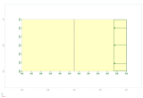

# Reset of nodal positions after a non-converged step

This test reproduces issue [#15007](https://github.com/KratosMultiphysics/Kratos/issues/15007): when a solution step does not converge, the state is reverted to the start of that step. When the mesh is not moved (`"move_mesh_flag": false`), this revert must not change the nodal positions. The test is run via both the Python route (`python` folder) and the C++ route (`cpp` folder), which use identical input files.

## Case Specification

The model consists of two `UPwSmallStrainElement2D4N` elements of $`1 \mathrm{m}`$ by $`1 \mathrm{m}`$ that are placed next to each other (element 1 on the left, element 2 on the right):

Both elements are in the sub model part `soil` and use the `GeoMohrCoulombLawPlaneStrain` constitutive law with the following parameters:

| Parameter       | Value               |
|-----------------|---------------------|
| Young's modulus | $`100 \mathrm{Pa}`$ |
| Poisson's ratio | $`0.0`$             |
| Cohesion        | $`6 \mathrm{Pa}`$   |
| Friction angle  | $`30^\circ`$        |
| Dilatancy angle | $`0^\circ`$         |

The water pressure is fixed to $`0.0 \mathrm{Pa}`$ at all nodes and the drainage type is set to `CONSTANT_PW_FIELD`. The left edge (`SideLeft`) is fixed horizontally, and the bottom edge (`SideBottom`) is fixed vertically. The model is loaded by prescribing the horizontal displacement of the right edge (`SideRight`) with a table:

| Time [s] | Displacement [m] |
|----------|------------------|
| 0.0      | 0.0              |
| 1.0      | -0.2             |
| 2.0      | -0.4             |

The analysis runs from $`t = 0 \mathrm{s}`$ to $`t = 2 \mathrm{s}`$ with a time step of $`1.0 \mathrm{s}`$. The Newton-Raphson strategy uses a residual criterion with `max_iterations` equal to 5, `number_cycles` equal to 2 and a `reduction_factor` of 0.5. The step to $`t = 2.0 \mathrm{s}`$ does not converge within 5 iterations, so the state is reverted to the start of that step, the time step is halved and the step is retried. As a result, the output contains the times $`1.0 \mathrm{s}`$, $`1.5 \mathrm{s}`$ and $`2.0 \mathrm{s}`$.

## Expected results

At $`t = 2.0 \mathrm{s}`$, the displacement of the right edge is $`-0.4 \mathrm{m}`$ and the middle nodes (nodes 2 and 5) are displaced by $`-0.2 \mathrm{m}`$. Both elements have a horizontal strain of $`-0.2`$ and, since the Young's modulus is $`100 \mathrm{Pa}`$, a horizontal Cauchy stress of $`-20 \mathrm{Pa}`$.

The test asserts the output times (to make sure the step was cut back), the nodal displacements, and the strains and stresses at the integration points. For the Python route, it also asserts that the nodal coordinates still equal the initial ones.

If the nodal positions were updated during the revert, the elements would be shortened for the remainder of the analysis, which changes the computed strains and displacements.
