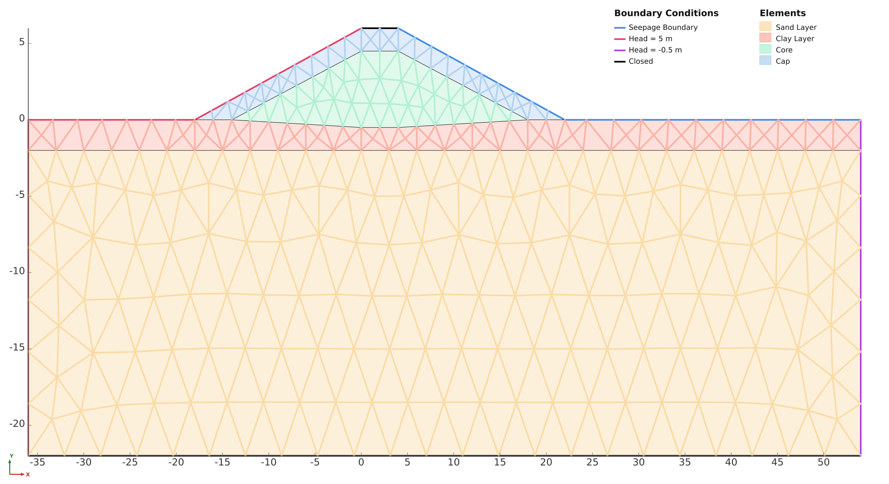

# Levee seepage test

This test compares the results of a levee model in Kratos GeoMechanicsApplication with results
from the same model in a different comparable finite-element software package. The test performs a steady state water pressure calculation (using SteadyStatePwElement2D3N elements) using a Van Genuchten retention law to describe the permeability and (effective) saturation behavior depending on the water pressures.

## Setup

The `find_phreatic_surface_and_outflow_region` stage solves steady-state groundwater flow with
`SteadyStatePwElement2D3N` elements and a Van Genuchten retention law.
The sand layer, clay layer, levee core and levee cap currently share the same
hydraulic material parameters.

- The initial phreatic line passes through (-36, 5), (-2, 5), (15, -0.5)
  and (54, -0.5), with coordinates in metres.
- The river head is prescribed at y = 5 m.
- The polder head is prescribed at y = -0.5 m.
- A seepage boundary is applied to `SeepageBoundary`.
- Gravity acts in the negative y direction.



## Reference results

The commercial FE reference data is extracted and put in 3 csv files:

| File | Columns | Units |
| --- | --- | --- |
| `reference_phreatic_line.csv` | `X,Y` | Both coordinates in m |
| `reference_flux_at_x_20.csv` | `Y,Flux` | Elevation in m; flux magnitude in m/day |
| `reference_saturation_at_x_4.csv` | `Y,Effective Saturation` | Elevation in m; effective saturation as a fraction from 0 to 1 |

The commercial FE results are supplied at selected coordinates. These locations do not necessarily coincide with Kratos mesh nodes.

## Assertions

The test runs the orchestrator and reads the nodal output at time = 1.0 from the GiD output file `levee_seepage_find_phreatic_surface_and_outflow_region.post.res`
and compares results at every supplied reference coordinate:

- **Phreatic line:** the water-pressure profile at each reference x is interpolated to find its p = 0 crossing. The resulting y-coordinate is compared with the reference y using an absolute tolerance of
  **0.15 m**. A missing or non-unique crossing fails explicitly. Use the x-coordinates
  from the reference data where the phreatic elevation is uniquely defined.
- **Flux magnitude at x = 20 m:** interpolate the three components of the nodal
   `FLUID_FLUX_VECTOR` at each y from the reference data, then calculate the magnitude
  and convert from m/s to m/day. The tolerance is the larger of **8.5% of the
  reference flux magnitude** and **0.01 m/day**.
- **Effective saturation at x = 4 m:** interpolate the nodal
  `EFFECTIVE_SATURATION` at each y from the reference data and compare using an
  absolute tolerance of **0.075** in fractional units.

Flux and saturation are integration-point results extrapolated to nodes by the configured auxiliary process. 
This extrapolation process may create unphysical values such as effective saturation slightly exceeding 1, especially where the mesh is coarse or the saturation gradient is steep. This does not mean that the simulation itself produces unphysical results.

## Additional observations

In the saved Kratos result, the water pressure reaches zero at the seepage-face node (20.2, 0.60). On this
mesh, the exit is therefore at x = 20.2 m. The reference calculation's exit point is at x = 19.41 m.

The fixed heads hold exactly: −270 kPa at the bottom left corner, −215 kPa at the
bottom right, and 10 kPa at the crest's outer corner (0, 6).

At x = 0, the phreatic elevation is 4.15 m in Kratos and 4.0449 m in the reference
CSV. At x = 16, it is approximately 1.5789 m in Kratos and 1.5545 m in the reference
CSV. The differences are about 0.105 m and 0.024 m, respectively, both within the
test's 0.15 m tolerance.

A notable difference is the suction in the dry soil of the outer layer under the
crest: at (4, 6) it is 17.70 kPa here against 25.67 kPa in the reference calculation.
It comes from Kratos' flow element, not from the model: the element weighs the
water's weight by the Bishop coefficient, which `VanGenuchtenLaw` takes equal to the
effective saturation (`UPwSmallStrainElement::CalculateFluidBodyFlow`). Above the
phreatic line, where the water hardly moves, the suction then grows with height by
Se × 10 kPa/m instead of 10 kPa/m. At x = 4, the Kratos phreatic elevation is
y = 3.422 m; from there to the crest, the suction increase is 12.21 kPa in Kratos
versus 25.78 kPa for a hydrostatic profile. The reference Van Genuchten law's
saturation and relative-permeability results match Kratos' to machine precision.
The suction difference also persists with a finer quadratic mesh and a tighter
tolerance. Below the phreatic line Se = 1, and the two agree.

## Plots and running the test

From the repository root, with a Python environment containing Kratos,
GeoMechanicsApplication and LinearSolversApplication, run:

```powershell
python applications\GeoMechanicsApplication\tests\test_levee_seepage.py
```

Setting `set KRATOS_GEO_MAKE_TEST_PLOTS=on` enables comparison
plots. The test creates `phreatic_line.svg`, `fluxes_for_x_20.svg` and
`saturation_for_x_4.svg` in this folder before the numerical comparisons.
The phreatic-line plot samples the Kratos line at the x coordinates from the reference data.
The other plots show the interpolated vertical mesh profiles at x = 20 m and x = 4 m, respectively for the flux and effective saturation comparisons.