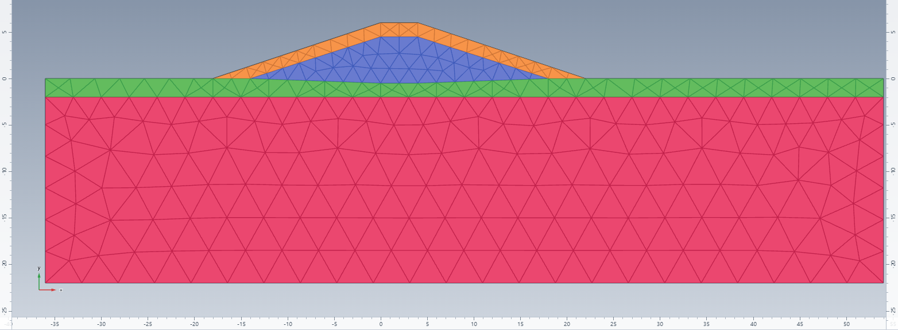

# Levee seepage test

This test compares the results of a levee model in Kratos GeoMechanicsApplication with results
from the same model in a different comparable finite-element software package. The test performs a steady state water pressure calculation (using SteadyStatePwElement2D3N elements) using a Van Genuchten retention law to describe the permeability and (effective) saturation behavior depending on the water pressures.

## Setup

The `find_equilibrium` stage solves steady-state groundwater flow with
`SteadyStatePwElement2D3N` elements and a Van Genuchten retention law.
The sand layer, clay layer, levee core and levee cap currently share the same
hydraulic material parameters.

- The initial phreatic line passes through (-36, 5), (-2, 5), (15, -0.5)
  and (54, -0.5), with coordinates in metres.
- The river head is prescribed at y = 5 m.
- The polder head is prescribed at y = -0.5 m.
- A seepage boundary is applied to `SeepageBoundary`.
- Gravity acts in the negative y direction.



## Reference results

The commercial FE reference data is extracted and put in 3 csv files:

| File | Columns | Units |
| --- | --- | --- |
| `expected_phreatic_line.csv` | `X,Y` | Both coordinates in m |
| `expected_flux_at_x_20.csv` | `Y,Flux` | Elevation in m; flux magnitude in m/day |
| `expected_saturation_at_x_4.csv` | `Y,Effective Saturation` | Elevation in m; effective saturation as a fraction from 0 to 1 |

## Assertions

The test runs the orchestrator and reads the GiD output file `levee_seepage_find_equilibrium.post.res`
and compares results at every supplied reference coordinate:

- **Phreatic line:** interpolate the water-pressure profile along the actual
  mesh at each reference x and find its p = 0 crossing. Compare 
  with reference y using an absolute tolerance of
  **0.15 m**. A missing or non-unique crossing fails explicitly. Use reference
  x coordinates where the phreatic elevation is uniquely defined.
- **Flux magnitude at x = 20 m:** interpolate the three components of the nodal
   `FLUID_FLUX_VECTOR` at each y from the reference data, then calculate the magnitude
  and convert from m/s to m/day. Compare using a relative tolerance of **0.085**
  (8.5%) of the flux magnitude, or an absolute tolerance of **0.01 m/day** for small fluxes.
- **Effective saturation at x = 4 m:** interpolate the nodal
  `EFFECTIVE_SATURATION` at each y from the reference data and compare using an
  absolute tolerance of **0.075** in fractional units.

Flux and saturation are integration-point results extrapolated to nodes by the configured auxiliary process. 
In this extrapolation process values may show inphysical behaviour such as effective saturation slightly exceeding 1, especially where the mesh is coarse or the saturation gradient is steep. This does not indicate a failure of the simulation.

## Plots and running the test

From the repository root, with a Python environment containing Kratos,
GeoMechanicsApplication and LinearSolversApplication, run:

```powershell
python applications\GeoMechanicsApplication\tests\test_levee_seepage.py
```

Setting `set KRATOS_GEO_MAKE_TEST_PLOTS=on` enables comparison
plots. The test creates `phreatic_line.svg`, `fluxes_for_x_20.svg` and
`saturation_for_x_4.svg` in this folder before the numerical comparisons.
The phreatic-line plot samples the Kratos line at the x coordinates from the reference data.
The other plots show the interpolated vertical mesh profiles at x = 20 m and x = 4 m, respectively for the flux and effective saturation comparisons.